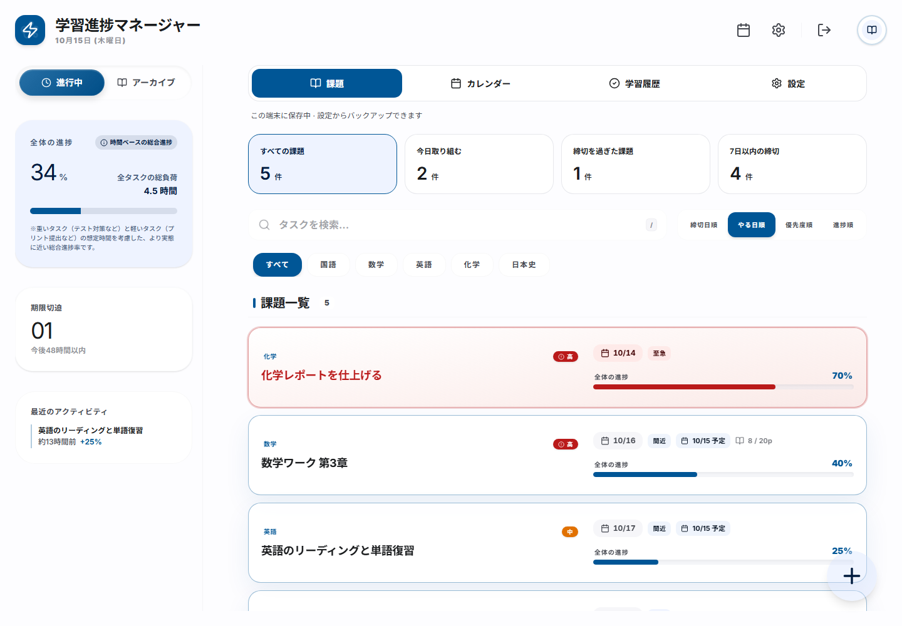

# Lumina — 学習進捗マネージャー

**今日の勉強を、ひとつずつ。**

学生の課題・締切・勉強の予定と、取り組んだ時間をまとめて管理するWebアプリです。スマートフォンでもPCでも利用できます。



[スマートフォンの画面を見る](docs/images/mobile.png)

## できること

- **今日やることを選ぶ** — 全課題／今日取り組む／締切超過／7日以内の締切を切り替え、教科やキーワードで絞り込めます。
- **課題を計画する** — 締切と取り組む日を別々に設定。優先度、所要時間、メモ、毎日・毎週・毎月の繰り返しにも対応します。
- **カレンダーで見渡す** — 月・週・年の表示、予定の登録、ドラッグでの学習予定変更に対応します。
- **勉強を記録する** — ストップウォッチ、集中と休憩を切り替えるポモドーロ、ページ数またはパーセントでの進捗記録を利用できます。
- **自分に合う表示にする** — 日本語／英語、ライト／ダークなどのテーマ、教科の追加・並び替えに対応します。
- **保存方法を選ぶ** — Googleアカウントによるクラウド同期、またはログイン不要の端末保存を利用できます。
- **バックアップする** — 設定から課題と学習記録をJSONで書き出し、別の端末やアカウントに追加できます。

## 使い始める

1. 起動画面で **「ログインせずに、この端末で始める」** または **「Googleでログイン」** を選びます。
2. **課題を追加** からタイトル・教科・締切を入力します。取り組む日も指定すると「今日取り組む」に表示されます。
3. 課題の詳細で **取り組む** を選んで勉強を始め、終了後に進んだ量を記録します。タイマーを使わず **進捗を入力** することもできます。
4. 完了した課題は **学習履歴** に移ります。「進行中に戻す」で進捗を0に戻して再開できます。

かんたん入力の例: `明日17時までに数学のテスト勉強 3時間`。教科・締切・所要時間などをフォームに反映します。外部AI APIを使わないルールベースの解析なので、APIキーや送信料金は不要です。

ページ形式は両端を含みます。例: p.1〜p.10は10ページ、1ページ進めると10%です。進んでいない日は **0** を入力して、勉強時間だけ記録できます。休憩は学習時間に含めません。

### 保存について

| モード | 保存先 | 別端末への同期 |
| --- | --- | --- |
| 端末保存 | 利用中のブラウザーのlocalStorage | JSONの書き出し・読み込み |
| Googleログイン | 既存FirebaseプロジェクトのCloud Firestore | 同じGoogleアカウントで同期 |

端末保存では、ブラウザーのデータ削除やプライベートモード終了でデータを失う場合があります。設定から定期的にバックアップしてください。端末保存とクラウド保存はそれぞれ独立しています。移す場合は書き出してから、移動先で読み込んでください。読み込みは追加方式で、現在の保存先に同じIDの課題がある場合はスキップします。1ファイル400件・4MB以内です。

タイマーは再読み込み後も復元されます。通知は設定画面のボタンから許可した場合に利用でき、アプリを開いている間に動作します。アプリを閉じた状態のプッシュ通知や、初回ロードを含む完全なオフライン起動には対応していません。

## ローカル開発

Node.js 22以上（推奨24）とnpmを用意します。

```sh
npm ci
npm run dev
```

[http://localhost:3000](http://localhost:3000) を開きます。端末保存は環境変数なしで利用できます。

既存のFirebase構成は `firebase-applet-config.json` にあります。別プロジェクトを利用する場合は `.env.example` を `.env.local` にコピーし、`VITE_FIREBASE_*` をまとめて設定してください。名前付きデータベースを利用しているため、`VITE_FIREBASE_DATABASE_ID` も確認してください。デフォルトDBに変更する場合は `(default)` を指定します。

FirebaseのWeb構成値はブラウザーに公開される識別情報です。管理者用サービスアカウントの秘密鍵などは `VITE_*` に設定しないでください。データのアクセス制御はFirebase AuthenticationとFirestore Security Rulesで行います。GeminiのAPIキーは不要です。

## Vercelへのデプロイ

このアプリはViteの静的SPAです。サーバー用のAPIやローカルファイルへの永続保存には依存しません。

1. VercelにこのGitHubリポジトリを接続します。既存プロジェクトを使う場合は、その接続先を確認します。
2. **Framework Preset: Vite**、**Root Directory: リポジトリのルート**、**Build Command: `npm run build`**、**Output Directory: `dist`**、**Node.js: 24.x** に設定します。
3. 別のFirebaseプロジェクトを使う場合のみ、Vercelにも `.env.example` と同名の環境変数を設定します。変更後は再デプロイします。
4. Previewで下記の動作確認を行ってからProductionに反映します。

`vercel.json` には `/tasks`、`/calendar`、`/history`、`/settings` を直接開いても表示できるSPA rewriteが含まれています。課題の詳細・追加・編集はクエリ文字列で復元し、ブラウザーの戻る・進むにも追従します。

### Googleログインを有効にする

Firebase Consoleで次の設定を確認します。

1. **Authentication → Sign-in method** でGoogleを有効にします。
2. **Authentication → Settings → Authorized domains** に、実際に使うVercel本番ドメインと検証用の安定したPreviewドメインを追加します。ローカルでログインする場合は `localhost` も登録します。
3. Firestoreに `firebase-applet-config.json` と一致するデータベースが存在することを確認します。
4. `firestore.rules` を対象DBへ反映します。Firebase CLIを使う場合は `firebase login` 後、`.firebaserc` と `firebase.json` のプロジェクト・DB名を確認してから `firebase deploy --only firestore:rules` を実行します。別プロジェクトを使うときは両ファイルも変更してください。

既存の `submissions` と `users` コレクションを引き続き利用します。課題は所有者のUIDで絞り込み、ルールでも本人のみの読み書きを許可します。アプリのデプロイだけではFirebaseの認証ドメインやルールは更新されません。

参考: [Vite on Vercel](https://vercel.com/docs/frameworks/frontend/vite)、[Google認証](https://firebase.google.com/docs/auth/web/google-signin)、[Firestoreのトランザクション](https://firebase.google.com/docs/firestore/manage-data/transactions)。

## 検証

```sh
npm test                         # 日付・進捗・月末繰り返し・入力解析
npm run build                    # TypeScript型チェック + 本番ビルド
npx playwright install chromium  # 初回のみ（Linux CIでは --with-deps を追加）
npm run test:e2e                  # PC・スマートフォンの実ブラウザーテスト
npm audit --omit=dev
```

Playwrightは本番ビルドの `dist` を使用します。ローカルのE2Eテスト前に `npm run build` を実行してください。外部環境を確認する場合は環境変数 `BASE_URL` を設定します。E2Eは端末保存を利用し、実アカウントのデータを書き換えません。Google OAuthと本番Firestoreの接続は、デプロイ先で別途確認してください。

GitHub Actionsで型チェック・単体テスト・本番ビルド・PC/モバイルE2E・依存監査を実行します。

### 公開前の動作確認

- `/calendar` と `/settings` を直接開き、再読み込み・戻る・進むを試す。
- 課題の追加・編集・検索・完了・再開・削除と、カレンダーからの追加を試す。
- p.1〜p.10を登録し、1ページ進めると10%になることを確認する。
- タイマーの一時停止・再開・再読み込みと、学習記録の保存を確認する。
- Googleログインした本人の課題が読み書きでき、ログアウト後に表示されないことを確認する。
- バックアップの書き出し・読み込みを試す。

## 構成

| ファイル | 役割 |
| --- | --- |
| `src/App.tsx` | 課題・カレンダー・設定のUI |
| `src/hooks/useNavigation.ts` | URLと画面・ダイアログの同期 |
| `src/hooks/useStudyTimer.ts` | 実時間を基準にした計測と復元 |
| `src/hooks/useModalFocus.ts` | ダイアログのフォーカス管理 |
| `src/lib/task-repository.ts` | 端末保存／Firestore、繰り返し課題の一括保存、学習記録のトランザクション |
| `src/lib/tasks.ts` | 日付の正規化・ページ進捗・完了状態・繰り返し日付 |
| `src/lib/smart-input.ts` | かんたん入力の解析 |
| `src/components/` | 学習の見通し・バックアップ・エラー画面 |
| `tests/` | 単体・E2E回帰テスト |
| `firestore.rules` | 所有者別のアクセス制御とデータ検証 |

React 19 / TypeScript / Vite / Tailwind CSS 4 / Firebase / date-fns / dnd-kit / Motionを使用しています。
